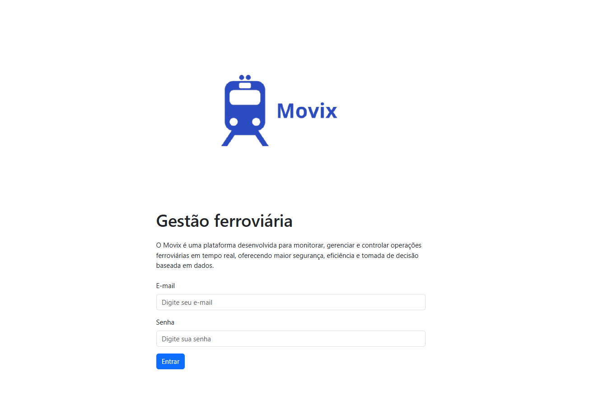
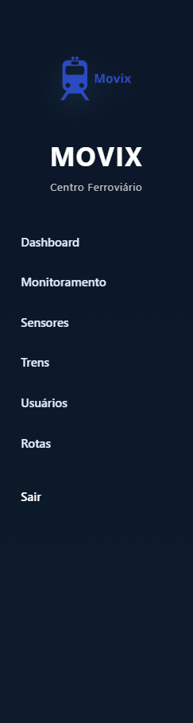
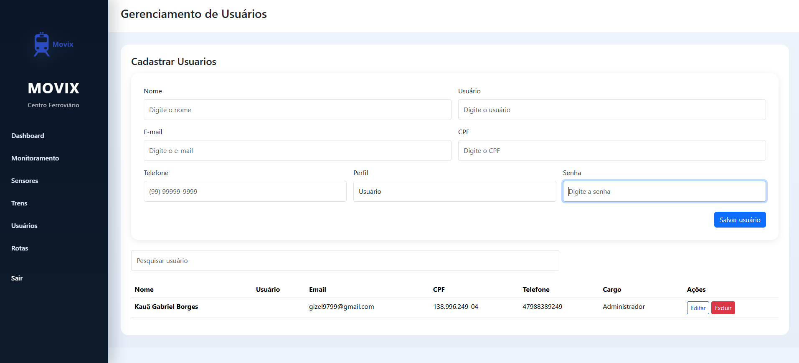
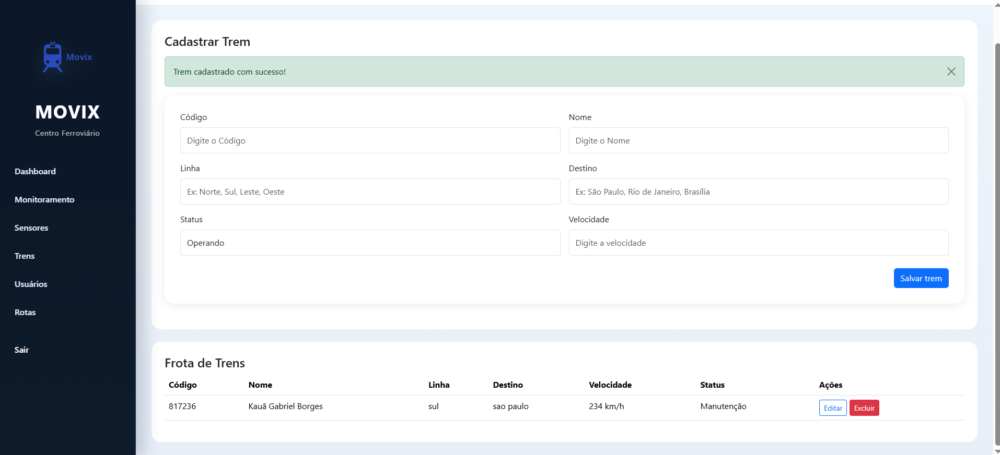
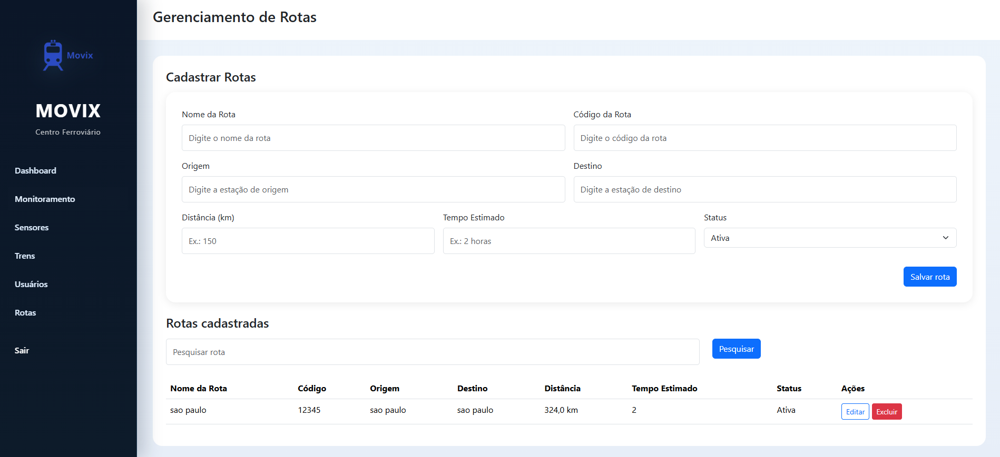
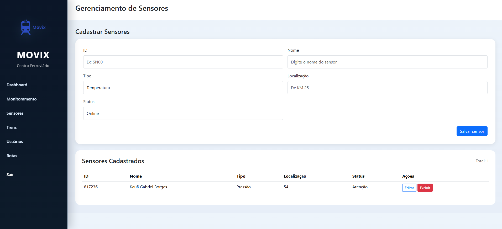
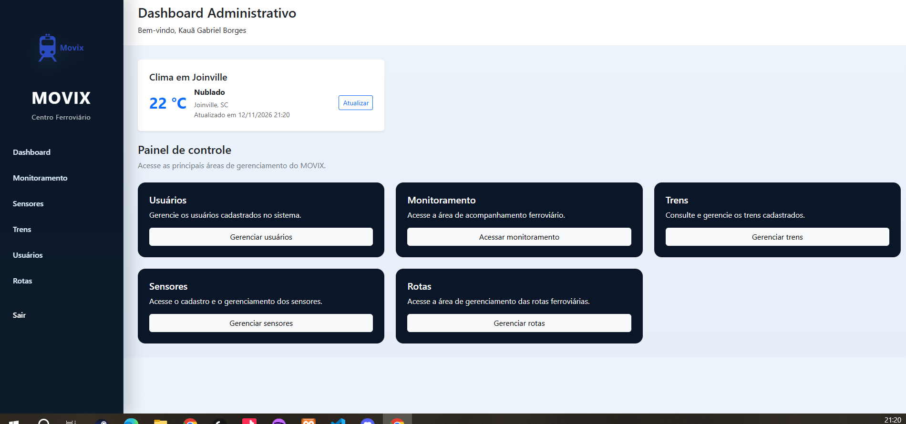
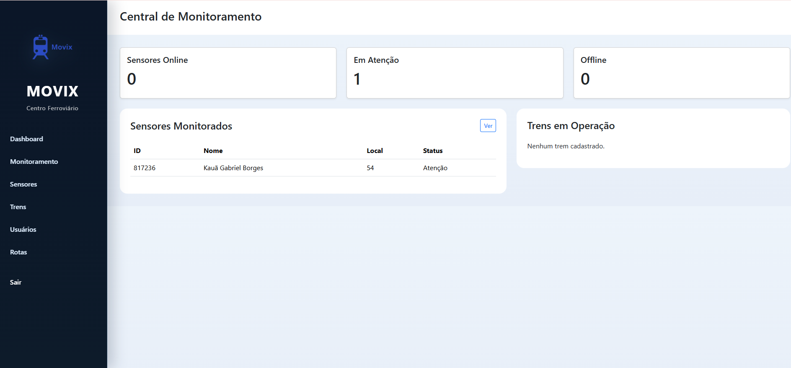

# Manual do Sistema MOVIX - Gestão Ferroviária Inteligente

Este documento apresenta o manual de instruções completo para a utilização do sistema **MOVIX** (Gestão Ferroviária Inteligente), desenvolvido como parte da Situação de Aprendizagem Ferrorama. O sistema foi projetado para centralizar o monitoramento, o controle e a gestão de operações ferroviárias em tempo real.

---

## 1. Como Acessar o Sistema

O MOVIX é uma aplicação web acessível diretamente pelo navegador. 

1. Certifique-se de que o servidor local (XAMPP / Apache / MySQL) esteja em execução no seu ambiente de desenvolvimento.
2. Abra o seu navegador web (Google Chrome, Firefox, Edge, etc.).
3. Digite o endereço do projeto (por exemplo: http://localhost/KauaBorges2026/S.A-Projeto-Movix/) ou acesse a página inicial do sistema.
4. Você visualizará a tela de login institucional do MOVIX.

> **Nota:** Caso ainda não possua uma conta de acesso padrão ou necessite de credenciais, utilize a opção de cadastro ou contate o administrador do sistema.

*Figura 1: Tela de login com campos de e-mail, senha e botão de acesso.*

---

## 2. Como Realizar Login e Logout

### Realizando Login
1. Na página inicial do sistema, preencha os campos obrigatórios de autenticação:
   - **E-mail:** Digite o e-mail cadastrado no sistema (ex: dmin@movix.com ou o seu e-mail pessoal).
   - **Senha:** Digite a sua senha de acesso.
2. Clique no botão **" Entrar\**.
3. Se as credenciais estiverem corretas, você será redirecionado para o **Dashboard** correspondente ao seu perfil.

### Realizando Logout (Sair)
1. Em qualquer página do sistema, localize o **Menu Lateral (Sidebar)** à esquerda.
2. Na parte inferior do menu lateral, clique no botão **\Sair\**.
3. O sistema encerrará a sessão ativa com segurança e redirecionará você de volta à página inicial de login (index.php).

---

## 3. Como Navegar pelas Principais Funcionalidades

A navegação pelo MOVIX é centralizada através do **Menu Lateral (Sidebar)**, que permanece visível em todas as telas internas do sistema. Dependendo do seu nível de permissão (Perfil), as opções disponíveis podem variar.

As principais seções acessíveis são:
- **Dashboard:** Visão geral do sistema, indicadores operacionais e clima em Joinville.
- **Monitoramento:** Central de acompanhamento em tempo real de sensores e trens.
- **Sensores:** Listagem e acompanhamento dos sensores instalados na malha ferroviária.
- **Trens:** Consulta e gerenciamento dos trens da frota.
- **Rotas:** Consulta e gerenciamento das rotas ferroviárias, origens, destinos e distâncias.
- **Usuários:** Gerenciamento completo de contas de usuários (exclusivo para administradores).

*Figura 2: Menu lateral exibindo as opções de navegação do MOVIX.*

---

## 4. Como Cadastrar e Consultar Usuários

O gerenciamento de usuários é exclusivo para administradores (id_perfil = 1).

### Consultar Usuários
1. No menu lateral, clique em **\Usuários\** (usuarios.php).
2. O sistema exibe a tabela completa de usuários cadastrados com nome, e-mail, CPF, telefone e perfil.
3. Use o botão **\Ver mais\** para exibir registros adicionais caso a lista seja longa.

*Figura 3: Listagem de usuários no sistema MOVIX.*

### Cadastrar Usuários
1. Na página de **Usuários**, preencha o formulário com Nome, E-mail, Senha, CPF e Telefone.
2. Clique no botão **\Cadastrar\**.

---

## 5. Como Cadastrar e Consultar Trens

### Consultar Trens
1. No menu lateral, clique em **\Trens\** ( rens.php).
2. Consulte a tabela com código, nome, linha, destino, velocidade e status.

*Figura 4: Listagem de trens cadastrados.*

### Cadastrar Trens (Administrador)
1. Efetue login como Administrador e acesse a página **\Trens\**.
2. Preencha os campos de código, nome, linha, destino, velocidade e status, depois confirme.

---

## 6. Como Cadastrar e Consultar Rotas

### Consultar Rotas
1. Clique em **\Rotas\** no menu lateral (
otas.php).
2. Visualize as rotas cadastradas, origem, destino, distância, tempo estimado e status.

*Figura 5: Listagem de rotas ferroviárias.*

### Cadastrar Rotas (Administrador)
1. Na página de **Rotas**, preencha os dados da rota (nome, código, origem, destino, distância, tempo e status) e salve.

---

## 7. Como Cadastrar e Consultar Sensores

### Consultar Sensores
1. Clique em **\Sensores\** no menu lateral (sensores.php).
2. Consulte os sensores listados com ID, nome, tipo, localização e status.

*Figura 6: Listagem de sensores IoT.*

### Cadastrar Sensores
1. Preencha o formulário com código, nome, tipo, localização e status, em seguida confirme o cadastro.

---

## 8. Funcionalidades Exclusivas do Administrador

As seguintes ações e páginas exigem perfil de Administrador (id_perfil = 1):
1. **Gerenciamento de Usuários (usuarios.php):** Cadastro, edição e exclusão de contas.
2. **Cadastro e Exclusão de Trens ( rens.php):** Inclusão de novos trens na frota e remoção.
3. **Gerenciamento de Rotas (
otas.php):** Criação, alteração e exclusão de rotas ferroviárias.

---

## 9. Como Interpretar o Dashboard

1. **Clima em Joinville:** Exibe temperatura atual, condição climática e botão de atualização.
2. **Cards e Atalhos:** Atalhos para gerenciamento rápido de Usuários, Trens, Sensores, Rotas e Monitoramento.
3. **Indicadores de Monitoramento (monitoramento.php):** Contagem em tempo real de sensores online, em atenção, offline e trens ativos.

*Figura 7: Visão geral do Dashboard.*

*Figura 8: Central de Monitoramento em tempo real.*
